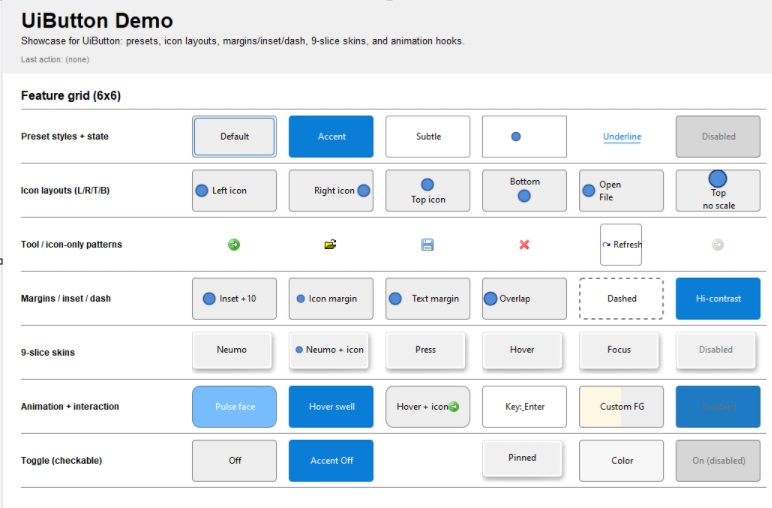
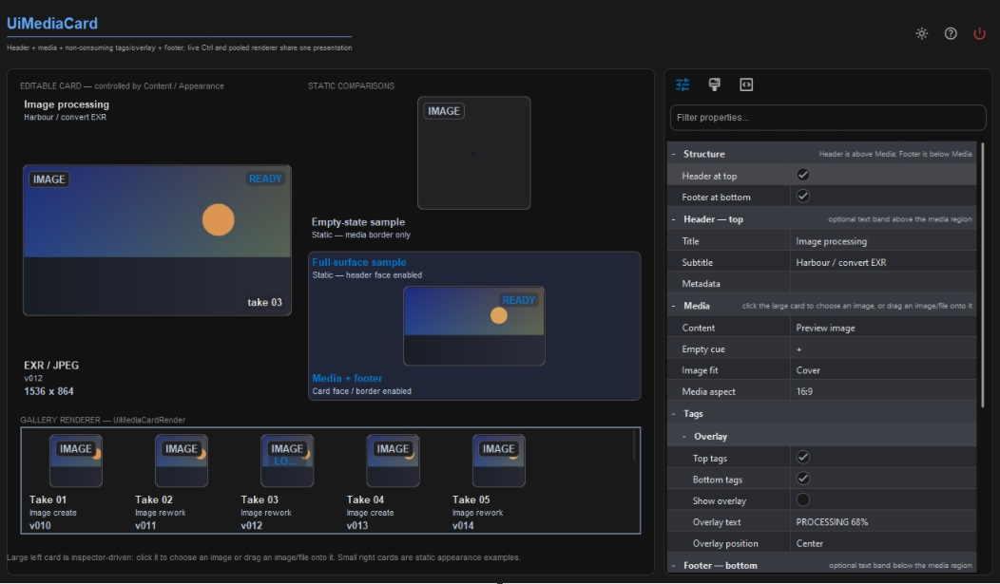
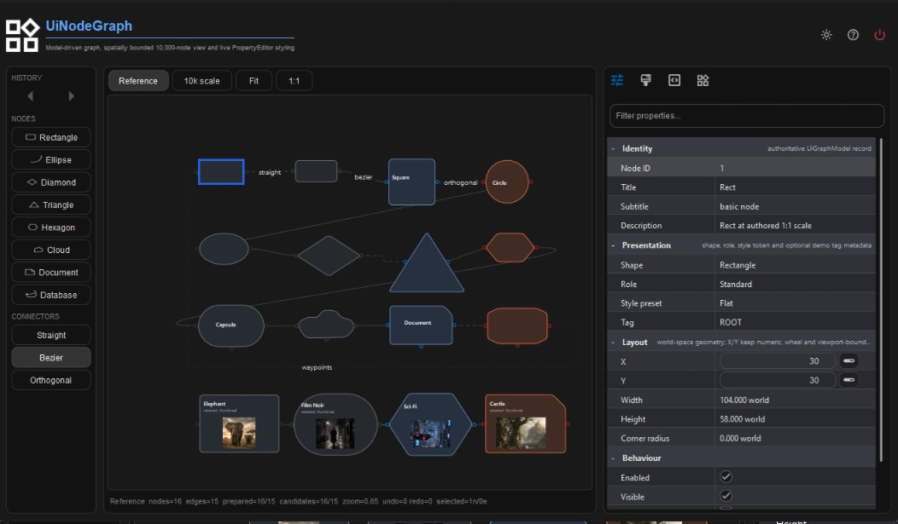

# U++ Ui

Style-first controls, layouts and model-backed views for Ultimate++.

Ui supplies shared themes, four semantic roles, modern controls, drawing helpers,
icons, media cards, and model-backed graph/document views. The optional file browser
adds themeable navigation and image-sequence handling. Ui can coexist with ordinary CtrlLib
controls. Reusable PropertyEditorCore and PropertyEditor packages support typed
property inspection without depending on UiDesigner.



## Start here

Read [Getting Started](GETTING_STARTED.md) to configure the assembly and build a
real demo. Browse the [Controls Guide](docs/01_UI_CONTROLS_GUIDE.md) for every public
control and its reference example. Full demos are self-contained packages with a
live preview, production PropertyEditor and C++ examples. MediaCard and Collection
are the accepted shell references; UiLabelDemo is a small starting example.

[Control usage recipes](docs/CONTROL_USAGE.md) give a small public API example for
every catalogue entry, including shared Frame Accent decoration on panel surfaces.

For AI-assisted work, see [Skills](skills/README.md): packaged native U++/Ui
development guidance and HTML mockups grounded in the available controls. Each
ZIP includes its instructions and supporting references.

## Control highlights

### Media cards

[UiMediaCardDemo](examples/UiMediaCardDemo) shows image and empty states, header and
footer content, tags, overlays, and the shared renderer used for gallery items.
The inspector and theme overrides drive the preview and generated C++.



### Node graphs

[UiGraphDemo](examples/UiGraphDemo) shows model-backed nodes, media, ports and
connections, with straight, Bezier and orthogonal routing. Explore node shapes,
roles and live property editing, then see the [graph guide](docs/08_UIGRAPH_GUIDE.md)
for integration and the specialized graph examples.



### File browsing

The optional [UiFileBrowser](Ui/UiFileBrowser/README.md) supports embedded and modal
use, detail and tile views, natural sorting, filters, image-sequence grouping and
JPEG/PNG/text previews. Additional preview formats use a host-supplied provider.
[UiFileDialogDemo](examples/UiFileDialogDemo) brings the Ui browser, OS-native
dialogs and the original U++ FileSel together in one example.

Build maintained demos with `python examples/build_demos.py --umk <path-to-umk.exe>`;
successful executables go in `bin/windows-x64`, with intermediate output and logs
in `build/demos`. See the [demo guide](docs/04_UI_DEMO_GUIDE.md) for individual
targets, shell conventions and generated-code requirements.

For a quick look without a compiler, download the Windows x64 demo ZIP from
[GitHub Releases](https://github.com/Trilec/upp_Ui/releases), extract it and run a
demo. Release bundles are prepared locally under `bin/releases` and include a
selection of the maintained demos, launch instructions and license notices.

## Release status

The current Ui release identity is defined only in [UiVersion.h](Ui/UiVersion.h).
The release-readiness pass is in progress: a release-candidate identifier is **not**
a certificate that every control, demo, generated recipe or platform has passed.
See [ACTIVE_WORK](docs/ACTIVE_WORK.md) for current published/validated boundaries
and the [coverage register](tests/ui_release_inventory.json) for remaining gates.
The [control audit](tests/CONTROL_AUDIT.md) records current findings, reproduced
defects and test results, including checks that still need manual validation.

The maintainer's validation environment is Windows, U++18468 and CLANGx64.
Validation is recorded per implementation slice. Do not infer Linux/macOS acceptance
from portable source or from an optional OS-dialog implementation. Existing sibling
package versions and saved-data schemas are independent of the Ui release number.

## Documentation

| Guide | Purpose |
| --- | --- |
| [Coding](docs/00_UPP_CODING_GUIDE.md) | ownership, APIs, packages, review and release rules |
| [Controls](docs/01_UI_CONTROLS_GUIDE.md) | complete control catalogue and practical contracts |
| [Control usage recipes](docs/CONTROL_USAGE.md) | short public API examples for every concrete catalogue entry |
| [Theme](docs/02_UI_THEME_GUIDE.md) | Minimal roles, states, inheritance and explicit styles |
| [Models](docs/03_UI_MODEL_GUIDE.md) | model authority, binding, transactions and UiDoc |
| [Demos](docs/04_UI_DEMO_GUIDE.md) | readable standalone demos and generated C++ |
| [PropertyEditor](docs/05_UI_PROPERTY_EDITOR_GUIDE.md) | schema, adapters, providers and editing lifecycle |
| [Drawing and Performance](docs/07_UI_DRAWING_GUIDE.md) | Draw/Painter/cache, geometry, DPI and large views |
| [UiGraph](docs/08_UIGRAPH_GUIDE.md) | graph use, templates, routes, hierarchy and examples |
| [UiGraph Development](docs/09_UIGRAPH_DEVELOPMENT.md) | retained layout/execution, workspace and open boundaries |

Source-adjacent U++ API topics remain reference material. Current work belongs in
the bounded ACTIVE_WORK file; completed checkpoint history belongs in Git.
[Changelog](CHANGELOG.md) records release-facing changes rather than every commit.

## Repository layout

`Ui/` is the library. `Utilities/` contains reusable PropertyEditor/authoring/icon
packages and regression executables. `examples/` contains demos and specialized
authoring tools. `tests/` contains additional tests, assets and the release inventory.
`scripts/` contains focused validation entry points. `docs/` contains the canonical
guides, focused reference contracts and ACTIVE_WORK (maximum 100 lines).
`skills/` contains the maintained skill sources and uploadable ZIPs; local backups
are excluded from Git.

## Validate a published implementation slice

After updating a clean main checkout, use PowerShell:

```powershell
powershell -NoProfile -ExecutionPolicy Bypass -File .\scripts\ValidateUiRelease.ps1
```

The default is a small Debug gate: build/run UiReleaseSmoke and RangeSegments tests,
then compile RangeSegmentsDemo and the UiLabel reference. It reads GitHubOut.var,
records exact source/toolchain evidence and leaves existing running demos alone.
Headers, Demos and Full profiles are explicit broader gates; they are not required
for every small edit. The existing Graph workspace gate remains separate.

**Ui and PropertyEditor are libraries, not executables.** Do not build Ui.exe or
add a dummy WinMain to fix an invalid library-as-application command.

## License

Apache License 2.0 — see [LICENSE](LICENSE). Preserve applicable attribution and
asset/dependency licenses when distributing a release.
